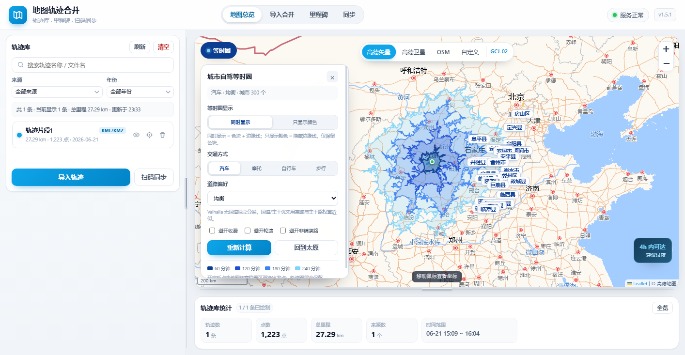
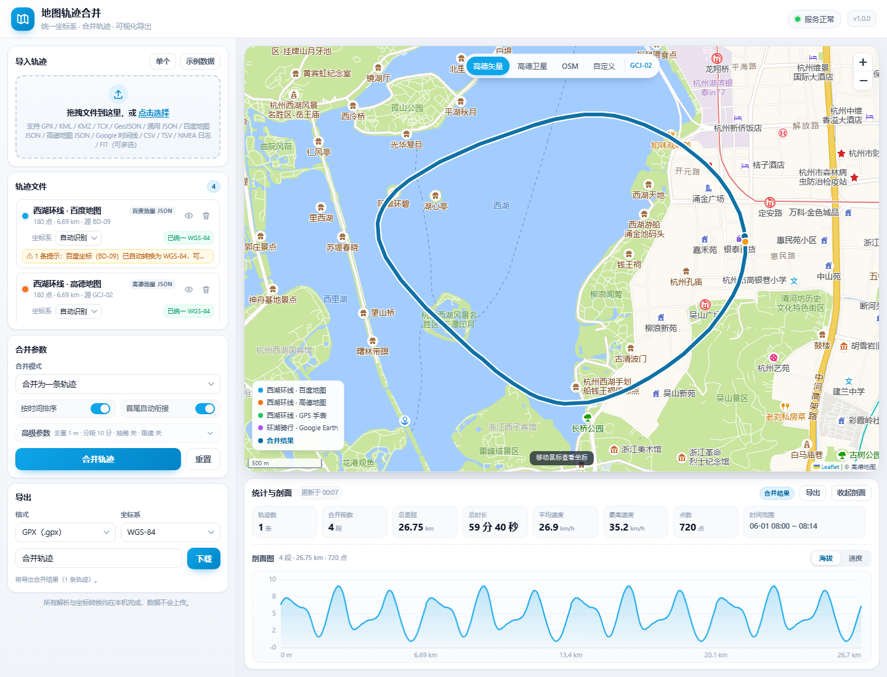
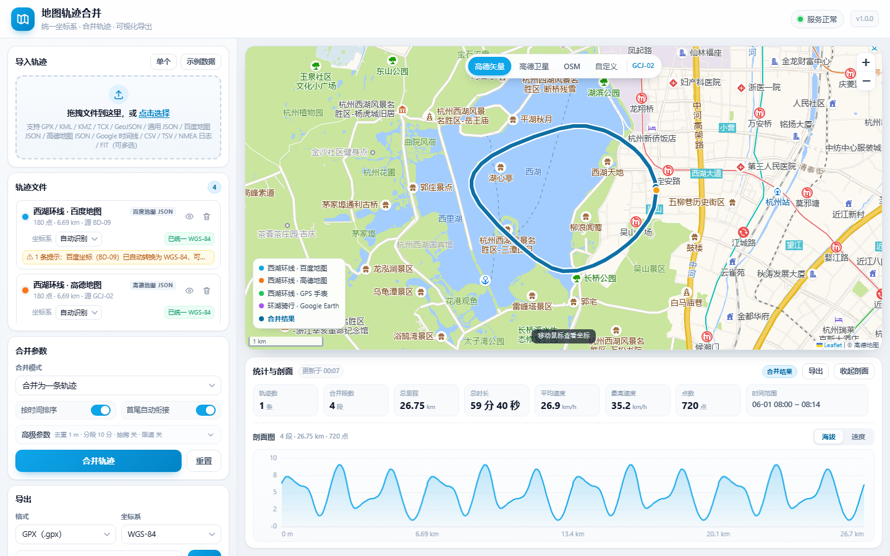
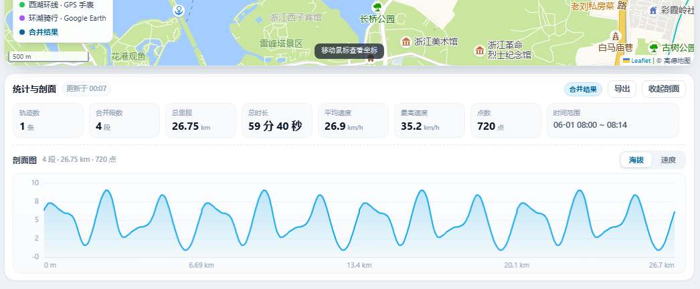
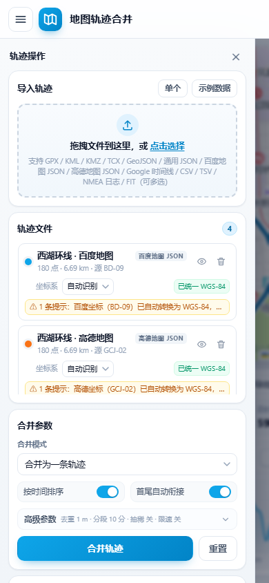
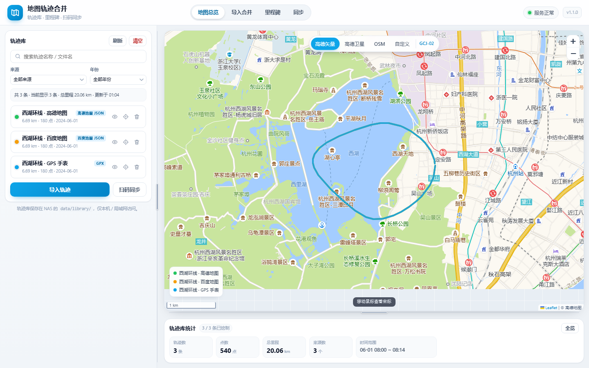
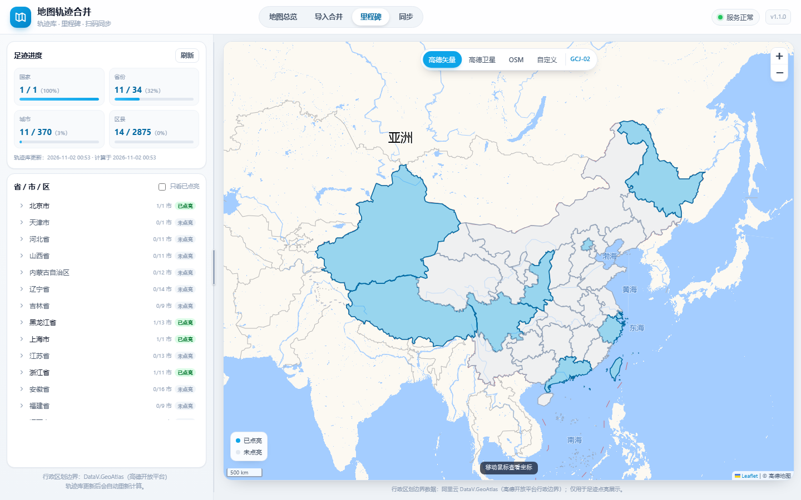
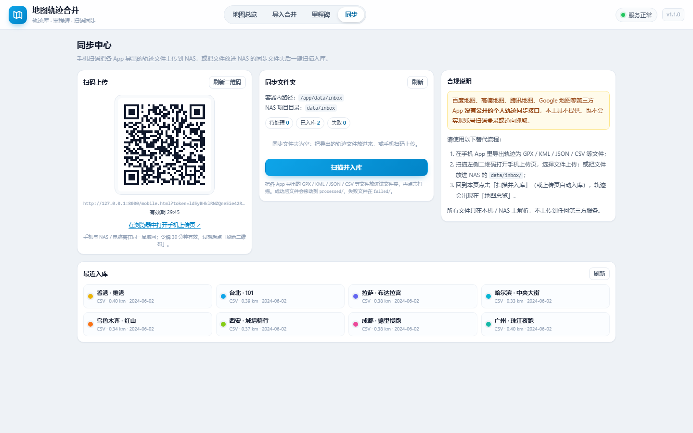
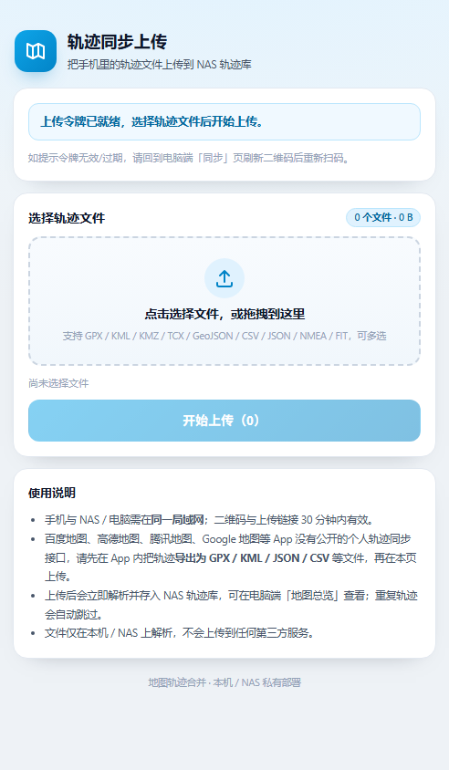

# 地图轨迹合并工具（MapTrack Merger）

> **GitHub 仓库：`zhangliangzuji`（<https://github.com/BH3XZT/zhangliangzuji>）**
>
> **这是一个 Docker 项目**：提供 [Dockerfile](Dockerfile) 与 [docker-compose.yml](docker-compose.yml)，可用 `docker compose up -d --build` 一键部署；同时也提供 Windows `start.bat`、macOS/Linux `start.sh` 一键脚本。构建过程不需要 `pip install`，只需要拉取基础镜像 `python:3.12-slim`。

把不同来源、不同坐标系的地图轨迹文件放在一起查看、合并、统计并导出，并长期沉淀成自己的「轨迹库」。

一个**零第三方依赖**的本地 Web 应用：后端只用 Python 3.12 标准库实现，前端使用本地 Leaflet，Docker 一键启动，浏览器打开即用。支持百度地图、高德地图、GPX / KML / KMZ / TCX / GeoJSON / CSV / NMEA / FIT / Google 时间线 等常见轨迹格式，自动识别格式与坐标系，把 WGS-84 / GCJ-02 / BD-09 统一转换后再合并与导出。

适合部署在自己的电脑或家庭 NAS（如飞牛 fnOS）上：轨迹数据保存在本地 `data/` 目录，手机扫码即可上传，不上传任何云端服务。

## 已集成：城市自驾等时圈地图

v1.3 起等时圈功能合并进 maptrack-merger；v1.4 增加出行方式与道路偏好；**v1.5 起等时圈直接叠加在「地图总览」的轨迹合并地图上，不再使用独立地图页面。**

- 在「地图总览」地图左上角点击 **「等时圈」**，等时圈图层叠加在当前轨迹地图上，轨迹图层保留
- 以太原（37.8706, 112.5489）为中心，计算 60/120/180/240 分钟可达范围
- **等时圈显示**：同时显示（色块 + 边缘）/ 只显示颜色（隐藏边缘线）
- **交通方式**：汽车、摩托车、自行车、步行，后端切换 Valhalla costing
- **道路偏好**：高速优先、国道/主干优先、均衡、避开高速；可叠加避开收费、避开轮渡、避开非铺装路
- 复用现有 Leaflet 地图与底图，叠加 OSM 中文城市标注、绿色脉冲起点；水系默认隐藏
- Valhalla 作为同一个 `docker-compose.yml` 里的可选 `isochrone` profile 运行
- 默认只下载山西/河北/河南/陕西约 276MB 的省级 OSM 数据，适合 8G–16G 内存的飞牛 NAS
- 数据构建脚本在 [`scripts/isochrone/`](scripts/isochrone/)，部署步骤见下方「等时圈部署」

> 不启动 Valhalla 时，轨迹合并、轨迹库、里程碑、同步等原有功能完全不受影响；
> 点击地图上的「等时圈」按钮会提示先启动等时圈服务。



- 无需安装 Python、Node.js，无需 `pip install`，构建时只需要拉取一个基础镜像
- 数据保存在本地/私有 NAS 的 `data/` 目录，不经过任何云端
- 默认访问地址：<http://localhost:8000>（部署在 NAS 时用 `http://<NAS局域网IP>:8000`）

**v2 新增：**

- **轨迹库（持久化）**：导入/同步的轨迹长期保存到 `data/library/`，首页默认是「地图总览」，一张地图叠加全部轨迹。
- **同步中心**：电脑端生成二维码 → 手机扫码上传轨迹；NAS 同步文件夹 `data/inbox` 一键扫描入库。
- **里程碑**：按轨迹库自动计算「国-省-市-区」4 级点亮，中国地图点亮省份，可展开省/市/区列表。
- **面板可拖拽**：左侧栏宽度、底部统计/剖面 dock 高度可拖动并记忆；手机端不启用。
- **独立手机上传页** `mobile.html`，不依赖主界面。

---

## 目录

- [界面预览](#界面预览)
- [功能特性](#功能特性)
- [支持的文件格式](#支持的文件格式)
- [坐标系说明](#坐标系说明)
- [一键启动](#一键启动)
- [页面与面板](#页面与面板)
- [轨迹库与地图总览](#轨迹库与地图总览)
- [导入、合并与导出](#导入合并与导出)
- [手机扫码上传](#手机扫码上传)
- [NAS 同步文件夹](#nas-同步文件夹)
- [里程碑：国/省/市/区点亮](#里程碑国省市区点亮)
- [数据与隐私](#数据与隐私)
- [合规说明](#合规说明)
- [常见问题](#常见问题)
- [目录结构](#目录结构)
- [升级与卸载](#升级与卸载)
- [免责声明](#免责声明)

---

## 界面预览



<p align="center">
  
  
</p>

手机端（侧栏抽屉展开）：

<p align="center"></p>

界面为中文，桌面与手机自适应：左侧是页面栏与操作区，右侧是地图。
想快速体验，可直接访问 <http://localhost:8000/?demo=1>：自动加载 4 个示例轨迹（百度、高德、GPX、KML）并完成合并。

### 轨迹库总览（v2）



<p align="center">
  
  
</p>

手机扫码上传页：

<p align="center"></p>

## 功能特性

- **多格式导入**：一次可上传多个文件，自动识别格式；单个文件失败不影响其它文件。
- **坐标系自动识别与转换**：识别 WGS-84 / GCJ-02 / BD-09，解析后统一转换为 WGS-84 内部坐标，也可手动指定源坐标系纠正识别错误。
- **地图可视化**：Leaflet 本地加载（无 CDN），支持高德矢量、高德卫星、OSM 与自定义瓦片；底图与轨迹坐标自动匹配，不再"偏移几百米"。
- **轨迹合并**：合并为一条轨迹（可选按时间排序、首尾衔接与自动分段、去重、抽稀、限速过滤），或保留多条轨迹只做转换与清理。
- **统计**：总里程、总时长、移动时长、平均 / 最高速度、点数、时间范围、轨迹段数。
- **剖面图**：Canvas 手绘海拔 / 速度剖面，随合并结果自动更新，鼠标悬停显示数值。
- **多格式导出**：GPX 1.1、KML 2.2（含 `gx:Track`）、GeoJSON、CSV（带 BOM，Excel 中文不乱码）、JSON；导出时可选择目标坐标系（WGS84 / GCJ02 / BD09）。
- **轨迹库（v2）**：导入或同步的轨迹持久化保存到 `data/library/`，服务端按轨迹内容自动去重；支持搜索、按来源/年份筛选、显隐、定位、重命名、改色、删除、清空。
- **地图总览（v2）**：默认首页，一张地图叠加全部可见轨迹，自动缩放到合适范围；统计卡显示轨迹数、点数、总里程与时间范围。
- **同步中心（v2）**：电脑生成二维码，手机在同一局域网扫码上传轨迹；也支持把文件放进 NAS 同步文件夹 `data/inbox/` 后一键扫描入库。
- **里程碑（v2）**：基于轨迹库计算「国-省-市-区」4 级点亮，中国地图点亮省份，可展开省/市/区明细。
- **面板可拖拽（v2）**：左侧栏宽度与底部 dock 高度可拖动，尺寸记忆在浏览器本地；手机端保持抽屉布局。
- **示例数据与演示模式**：内置示例轨迹，访问 `/?demo=1` 自动加载示例并合并（演示模式不会污染轨迹库）；`?demo=1&panel=open` 会在手机端自动展开侧栏。
- **数据本地化**：应用运行在本机 / 私有 NAS 的 Docker 中，数据保存在 `data/` 目录，随项目文件夹一起备份或删除。

## 支持的文件格式

| 格式 | 扩展名 | 常见来源 | 默认坐标系 |
| --- | --- | --- | --- |
| GPX | `.gpx` | 运动手表、手机运动 App、GPS 记录仪导出 | WGS-84 |
| KML | `.kml` | Google Earth、各类地图软件导出 | WGS-84 |
| KMZ | `.kmz` | KML 的压缩包形式 | WGS-84 |
| TCX | `.tcx` | Garmin 等运动设备训练文件 | WGS-84 |
| GeoJSON | `.geojson` / `.json` | GIS 工具、开发者导出 | WGS-84 |
| CSV | `.csv` | Excel、脚本生成的经纬度表格 | WGS-84（可切换） |
| NMEA | `.nmea` / `.txt` | 车载 GPS、GPS 模块原始语句 | WGS-84 |
| FIT | `.fit` | Garmin 手表 / 码表等运动设备 | WGS-84 |
| 百度地图轨迹 JSON | `.json` | 百度地图开放平台、百度地图轨迹导出 | BD-09 |
| 高德地图轨迹 JSON | `.json` | 高德开放平台、高德地图轨迹导出 | GCJ-02 |
| Google 时间线 JSON | `.json` | Google 地图时间线（Location History）导出 | WGS-84 |

说明：

- 实际支持列表以界面中的格式提示与后端 `/api/formats` 接口返回为准。
- 上传限制：单次请求合计 ≤ 64MB，单个文件 ≤ 32MB；网页导入、扫码上传、同步文件夹扫描使用同一套解析器与限制。
- 无法识别的文件会在结果中给出中文错误提示，不会中断整批导入。
- 坐标系识别使用启发式判断，个别文件可能识别错误，此时在界面上把该文件的坐标系下拉框改为正确值即可重新解析。

## 坐标系说明

中国的地图数据存在三套常用坐标系，互相之间存在偏移，这是"轨迹叠加到地图上错位几百米"的根本原因：

| 坐标系 | 全称 / 别名 | 典型来源 | 说明 |
| --- | --- | --- | --- |
| WGS-84 | 大地坐标系统 / GPS 原始坐标 | GPX、KML、OSM、Google 时间线、大部分运动设备 | 国际通用标准，与真实地理位置一致 |
| GCJ-02 | 国测局坐标 / "火星坐标" | 高德、腾讯、Google 中国区地图 | 在 WGS-84 基础上做了非线性偏移，偏移量随位置变化，通常为几十米到几百米 |
| BD-09 | 百度坐标 | 百度地图 | 在 GCJ-02 基础上再做一次偏移加密 |

为什么需要转换：

- 同一个地点，在 WGS-84、GCJ-02、BD-09 下经纬度数值不同，直接叠加会错位。
- 不同底图（OSM 用 WGS-84，高德用 GCJ-02，百度用 BD-09）显示同一坐标时也需要先换算。

本工具已经自动处理：

1. **导入**：识别文件的源坐标系（`自动`，可手动指定），统一转换为 **WGS-84** 后参与计算与入库。
2. **显示**：根据当前底图的坐标系，把 WGS-84 实时转换为该底图坐标（高德底图用 GCJ-02，OSM 用 WGS-84），因此轨迹与底图对齐；**里程碑的中国省界也会随底图 CRS 自动换算**。
3. **导出**：按你选择的导出坐标系（WGS84 / GCJ02 / BD09）再转换一次，方便回填到对应平台。

> 提示：坐标转换使用的是业界广泛采用的近似算法（GCJ-02 / BD-09 并非公开精确定义的坐标系），可能存在米级误差，详见文末免责声明。

## 一键启动

前置条件：电脑或 NAS 已安装并启动 **Docker Desktop**（Windows / macOS）或 **Docker Engine + compose 插件**（Linux / NAS）。不需要安装 Python 或任何依赖包。

### Windows（推荐）

1. 安装 Docker Desktop（详见 [安装流程.md](安装流程.md)）。
2. 解压整个项目文件夹，例如 `D:\maptrack-merger`。
3. **双击 `start.bat`**。

脚本会自动：检查 `docker` 命令 → 检查 Docker 是否运行 → 检查 `docker compose` → 构建镜像并后台启动容器 → 最多轮询 60 秒等待健康检查通过 → 自动打开浏览器 `http://localhost:8000`。若失败会在窗口中给出中文排查建议。

停止：双击 `stop.bat`。

### macOS / Linux

```bash
# 首次使用先赋可执行权限（从 Windows 复制过来的文件可能没有执行位）
chmod +x start.sh stop.sh

# 启动
./start.sh

# 停止
./stop.sh
```

脚本会构建镜像、启动容器、等待健康检查（最多 60 秒）并尝试用 `open` / `xdg-open` 打开浏览器；没有图形界面时会在终端打印访问地址。

### NAS（飞牛 fnOS 等）

把整个项目文件夹放到 NAS 的共享目录（例如与 `data/` 同级），在项目目录中执行一次 `docker compose up -d --build`（可通过 NAS 的 SSH 终端、计划任务或容器管理界面执行），然后访问 `http://<NAS局域网IP>:8000`。

- 数据（轨迹库、同步文件夹）通过 `./data:/app/data` 持久化在 NAS 项目目录下：`data/library/`、`data/inbox/`。
- **手机扫码上传必须用 NAS 的局域网地址打开网页**（不要用 `localhost` 生成二维码），详见 [手机扫码上传](#手机扫码上传)。
- 在 NAS 上使用同步文件夹、文件管理访问方式与权限设置，详见 [安装流程.md](安装流程.md) 的「5.8 在飞牛 NAS 上使用」。

### 手动命令（所有平台通用）

```bash
# 在项目根目录（与 docker-compose.yml 同级）
docker compose up -d --build

# 查看状态（STATUS 为 healthy 表示就绪）
docker compose ps

# 查看日志
docker compose logs -f

# 停止并移除容器（data 目录数据保留）
docker compose down
```

启动完成后，浏览器访问：

```text
http://localhost:8000
```

健康检查地址（应返回一段 JSON，`"ok": true`）：

```text
http://localhost:8000/api/health
```

### 修改访问端口

默认宿主机端口为 `8000`（容器内部端口固定为 8000，不需要改）。如果 8000 被占用，在项目根目录新建 `.env` 文件，写入：

```dotenv
MAPTRACK_PORT=9000
```

然后重新执行 `start.bat` / `./start.sh`（或 `docker compose up -d`），访问 `http://localhost:9000`。启动脚本会自动读取实际映射的端口。

## 页面与面板

顶栏有 4 个页签，默认打开「地图总览」：

| 页签 | 作用 |
| --- | --- |
| **地图总览** | 轨迹库首页，一张地图叠加全部可见轨迹，支持筛选、显隐、定位、删除 |
| **导入合并** | v1 的上传解析、合并参数、统计、剖面图与导出功能 |
| **里程碑** | 国/省/市/区 4 级点亮进度、中国地图与省市区列表 |
| **同步** | 手机扫码上传二维码、NAS 同步文件夹扫描、合规说明 |

面板调整（仅桌面端）：

- 左侧栏宽度可在 **280~600px** 之间拖动（右边缘拖拽条），底部 dock 高度可在 **140~480px** 之间拖动（上边缘拖拽条）。
- **双击拖拽条**恢复默认尺寸；尺寸保存在浏览器 localStorage（`mtm.sidebarWidth` / `mtm.dockHeight`），下次打开自动恢复。
- 手机端（窗口宽度 ≤900px）保持抽屉布局，拖拽功能自动禁用。

## 轨迹库与地图总览

轨迹库是本工具的长期数据，保存在 NAS 项目目录下的 `data/library/`（容器内 `/app/data/library`）。

- **入库方式**：在「导入合并」页上传解析成功后，若「自动存入轨迹库」开关打开（默认开），会自动调用保存接口入库；也可点击「把当前轨迹存入轨迹库」手动保存，合并结果同样可以存入。
- **去重**：服务端按轨迹内容去重，重复导入的轨迹会提示「已存在」而不会重复写入。
- **地图总览**：首页把轨迹库中所有可见轨迹按各自颜色叠加在同一张地图上，自动 `fitBounds`；左栏支持搜索、按来源筛选、按年份筛选、显示/隐藏、定位到轨迹、删除。
- **统计摘要**：轨迹数、点数、总里程、时间范围；选中轨迹时 dock 会显示对应的海拔/速度剖面。
- **清空轨迹库**：总览页提供「清空轨迹库」按钮（需要二次确认），会删除库中全部轨迹，操作不可恢复，请谨慎使用。
- 轨迹库为空时，页面会引导你去「导入合并」或「同步」页导入轨迹。

> 轨迹库数据也是普通文件，直接备份 NAS 上的 `data/library/` 目录即可。

## 导入、合并与导出

「导入合并」页保留 v1 的全部功能：

1. **上传轨迹**
   把轨迹文件拖进左侧上传区，或点击选择文件（支持一次多选）。也可以点击"示例数据"先体验。
2. **确认坐标系**
   每个文件卡片上有坐标系下拉框，默认"自动"。若发现轨迹与底图明显偏移，说明源坐标系识别错了，手动选择正确值（百度轨迹选 BD-09，高德轨迹选 GCJ-02，GPS/GPX 选 WGS84），工具会按同一文件重新解析。
3. **设置合并参数并合并**
   选择"合并为一条轨迹"或"保留多条轨迹"；按需开启按时间排序、首尾衔接、自动分段、去重、抽稀、限速过滤，然后点击"合并轨迹"。
4. **查看统计与剖面**
   地图上合并结果以加粗高亮线显示，统计卡显示里程、时长、速度等；剖面图可切换海拔 / 速度。
5. **导出**
   在导出区选择导出格式（GPX / KML / GeoJSON / CSV / JSON）和目标坐标系，点击下载。中文文件名可以正常保存。
6. **各 App 轨迹导出指南**
   百度/高德/腾讯等 App 没有公开的轨迹同步接口，需要先在手机 App 内导出文件。各 App 的具体导出步骤见 [docs/轨迹导出指南.md](docs/轨迹导出指南.md)，或访问网页版 <http://localhost:8000/guide.html>。文档内含华为运动健康、Garmin、Strava、两步路、六只脚、行者、Apple 健康、Google 时间线的导出步骤，以及百度/高德/腾讯的个人信息副本申请模板。

v2 补充：

- 上传解析成功后默认**自动存入轨迹库**（开关默认开启）；演示模式（`?demo=1`）解析的示例轨迹不会自动入库，避免污染你的轨迹库。
- 合并结果可以一键存入轨迹库，之后在「地图总览」中长期查看。

## 手机扫码上传

适用场景：轨迹在手机 App 里，想直接传到 NAS 上的轨迹库，不用开电脑。

前提：**手机和 NAS（或运行本工具的电脑）连接在同一个局域网 / Wi-Fi**，并且你用 NAS 的局域网 IP 访问网页。

步骤：

1. 在电脑或任意设备浏览器打开 `http://<NAS局域网IP>:8000`（例如 `http://192.168.1.20:8000`），进入「同步」页。
2. 点击生成二维码：二维码内容就是当前网页地址 + 手机上传页路径（`/mobile.html?token=...`），并带有一个 30 分钟内有效的临时令牌。
3. 手机用相机/微信/浏览器扫码，打开手机上传页（不依赖主界面）。
4. 在手机上选择 App 导出的轨迹文件（支持多选，常用格式如 GPX / KML / KMZ / JSON / CSV 等），点击上传。
5. 页面显示上传进度与结果：已入库 N 条 / 重复 N 条 / 解析失败的原因。成功后轨迹会立即出现在「地图总览」的轨迹库里。

说明与限制：

- 令牌（token）有效期 **30 分钟**，只保存在服务内存中；服务重启后失效，需要重新生成二维码。
- 上传限制与网页导入一致：单次请求 ≤ 64MB、单个文件 ≤ 32MB。
- 上传页链接里带有临时令牌，**不要在公开渠道分享这个链接或二维码截图**。
- 如果二维码是用 `localhost` / `127.0.0.1` 打开的页面生成的，手机会打不开——请改用 NAS 的局域网 IP 或域名访问后再生成。
- 上传的文件先保存到 NAS 的 `data/inbox/`（由服务端重命名，避免重名覆盖），自动入库成功后归档到 `data/inbox/processed/`；解析失败的文件会进 `data/inbox/failed/` 并附错误说明。入库结果在轨迹库里。

## NAS 同步文件夹

除了扫码，还可以直接把轨迹文件「丢」到 NAS 的同步文件夹，然后在网页上一键扫描入库：

- NAS 上（项目目录内）：`data/inbox/`
- 容器内对应路径：`/app/data/inbox`（「同步」页会显示这个路径）

使用步骤：

1. 在 NAS 的文件管理（飞牛的文件管理 / File Station 等）中打开项目目录下的 `data/inbox/`。
2. 把从各 App 导出的轨迹文件复制/上传到这里（可以一次放多个）。
3. 打开网页「同步」页，点「刷新」可以看到待处理文件列表（文件名、大小、修改时间）；点「扫描并入库」。
4. 扫描成功后：
   - 解析成功并入库的文件会被移动到 `data/inbox/processed/`；
   - 解析失败的文件会被移动到 `data/inbox/failed/`，并生成同名的 `*.error.txt` 说明失败原因。
5. 回到「地图总览」即可看到新轨迹；重复轨迹会被去重，不重复入库。

注意事项：

- 只扫描 `data/inbox/` 顶层的文件；子目录（含 `processed/`、`failed/`）不会被重复扫描。
- 容器内以非 root 用户（uid 10001）运行，需要 `data/inbox/` 可写；如果通过 NAS 文件管理上传后扫描报权限错误，可在 NAS 终端执行 `sudo chown -R 10001:10001 data`（详见 [安装流程.md](安装流程.md)）。
- 扫描是手动触发的，不会后台自动轮询，避免 NAS 上产生不可预期的 IO；需要时点一下「扫描并入库」即可。
- 成功入库的原始文件会保留在 `data/inbox/processed/`，可按需自行清理。

## 里程碑：国/省/市/区点亮

「里程碑」页根据轨迹库中所有轨迹的采样点，计算你点亮过的行政区：

- **4 级进度卡**：国家（1/1）、省（x/34）、市（x/y）、区（x/y），进度条显示完成比例。市级、区级的总数来自内置行政区划数据的实际数量，不同数据版本可能略有差异。
- **中国地图**：用离线行政区划边界绘制 34 个省级面；已点亮的省份高亮填充，未点亮为浅灰；鼠标悬停显示省名与是否点亮，点击可定位并展开对应列表。切换底图时会按底图坐标系重新请求边界数据。
- **省/市/区列表**：按省分组展示，可逐级展开市与区，带「已点亮 / 未点亮」徽章，支持只看已点亮。
- **自动更新**：里程碑由轨迹库计算，每次轨迹库变化后会重新计算；页面打开时显示最近一次计算时间。
- **空轨迹库**：会提示先导入轨迹。

数据来源与隐私：

- 行政区划边界：**阿里云 DataV.GeoAtlas（高德开放平台行政区划边界）**，已随项目打包为离线数据 `geo/china_admin.json.gz`（约 2.8MB），运行时**不需要联网下载**。页面底部也会注明该来源。
- 计算只在本地进行，不会把轨迹坐标上传到任何第三方服务。

## 数据与隐私

- **纯本地 / 私有化部署**：后端运行在你自己的电脑或私有 NAS 的 Docker 容器中；上传、同步、入库、里程碑计算全部在本机完成，不会上传到任何云端服务，也没有遥测、统计上报。
- **数据位置**：所有运行数据通过 `./data` 目录挂载到容器 `/app/data`：
  - `data/library/`：轨迹库（长期保存的轨迹），内含 `index.json`（索引与元数据）与 `tracks/*.json.gz`（每条轨迹的点位数据）
  - `data/inbox/`：待扫描的同步文件夹（含 `processed/`、`failed/`）
  - 停止容器（`docker compose down`）不会删除这些数据；只有删除整个项目文件夹才会一并删除。
- **备份建议**：定期备份 NAS 上的整个 `data/` 目录即可完整备份轨迹库；升级/重装前请先备份，注意 `index.json` 与 `tracks/` 要一起保留。
- **手机上传**：手机与 NAS 通过局域网直接通信，链路不经过公网（前提是两者在同一局域网）；上传页链接含 30 分钟有效的临时令牌，请勿分享。
- **地图瓦片**：底图（高德 / OpenStreetMap）由浏览器直接向瓦片服务商请求，需要联网。**轨迹数据本身不会发给瓦片服务商**，但你的 IP、浏览的瓦片范围对服务商可见。断网时页面与轨迹仍可用，只是底图空白，可切换为自定义瓦片或仅看轨迹。
- **访问安全**：应用本身没有登录鉴权，默认发布在宿主机的 8000 端口。在 Windows / macOS 本机使用时通常仅本机可访问；部署在 NAS 上时局域网设备可访问。**请勿直接暴露到公网**，如需远程访问请自行加反向代理与访问控制，并注意备份数据。

## 合规说明

- **不提供第三方 App 账号登录同步**：百度地图、高德地图、腾讯地图、Google 地图等**没有公开的个人轨迹同步接口**，通过逆向、抓包等方式拉取账号数据既不稳定也可能违反平台服务条款。因此本工具**不提供**任何账号密码登录、扫码授权登录第三方 App 的功能，也不会保存你的第三方平台账号信息。
- **推荐替代流程**：先在你使用的 App / 平台中把轨迹**导出为通用文件**，再通过本工具导入：
  1. 在 App / 平台中找到"导出轨迹"或"导出 GPX / KML / JSON"的能力（不同 App 与版本的入口不同，以你所用 App 的实际界面为准；部分平台需通过其开放平台的接口导出）；
  2. 把导出的文件用手机扫码上传（[手机扫码上传](#手机扫码上传)），或复制到 NAS 同步文件夹（[NAS 同步文件夹](#nas-同步文件夹)）；
  3. 打开网页后仅需确认来源坐标系（百度 BD-09、高德 GCJ-02、GPS/GPX WGS-84）。
- **行政区划数据**：里程碑使用的省级边界来源于阿里云 DataV.GeoAtlas（高德开放平台行政区划边界），仅用于本地可视化展示；请遵守数据提供方的使用条款。
- 本工具只读取你**主动提供**的文件，不抓取、不爬取任何第三方账号数据。使用第三方数据时请遵守对应平台的服务条款与当地法律法规。

## 常见问题

### 1. 端口 8000 被占用 / 启动时报 port is already allocated

- 临时改端口：项目根目录新建 `.env`，内容 `MAPTRACK_PORT=9000`，重新启动后访问 `http://localhost:9000`。
- 临时命令行方式：Windows PowerShell `$env:MAPTRACK_PORT=9000; docker compose up -d`；macOS/Linux `MAPTRACK_PORT=9000 docker compose up -d`。
- 查找占用进程：Windows `netstat -ano | findstr :8000`（再用任务管理器按 PID 结束）；macOS/Linux `lsof -i :8000`。
- 改完记得让浏览器访问新端口；`start.bat` / `start.sh` 会自动读取实际映射的端口。

### 2. 双击 start.bat 提示"未找到 docker 命令"或"Docker 引擎没有运行"

- 说明 Docker Desktop 未安装、未启动，或安装后尚未重启电脑。
- 打开 Docker Desktop，等待左下角显示 `Engine running`（鲸鱼图标变绿）后再试。
- WSL2 相关报错：管理员 PowerShell 执行 `wsl --update`，必要时 `wsl --shutdown` 后重启 Docker Desktop。
- 详细安装步骤见 [安装流程.md](安装流程.md)。

### 3. 首次构建 / 拉取镜像很慢或失败

- 构建只需要拉取 `python:3.12-slim` 这一个基础镜像（约几十 MB），不需要 `pip install`；离线行政区划数据 `geo/china_admin.json.gz` 已随项目打包，不额外联网下载。
- 国内网络可在 Docker Desktop → Settings → Docker Engine 中配置镜像加速，添加 `"registry-mirrors": ["<你的加速地址>"]` 后 Apply & Restart；加速地址请从你的云厂商容器镜像服务控制台获取。
- 完全离线：在有网机器执行 `docker pull python:3.12-slim`，再 `docker save python:3.12-slim -o python312-slim.tar`；把 tar 拷到目标机器后 `docker load -i python312-slim.tar`，再执行 `docker compose up -d --build`。
- 网络代理不稳定时先取消系统代理再重试，或稍后重试。

### 4. 上传中文文件名或导出中文文件名乱码 / 失败

- 本工具全程使用 UTF-8，中文文件名（如 `西湖徒步.gpx`）可以正常上传和导出。
- CSV 导出带 UTF-8 BOM，用 Excel 直接打开不会乱码；若用其它软件打开仍乱码，请选择按 UTF-8 编码导入。
- 若浏览器下载后文件名显示异常，请升级浏览器；不要手动把文件名改成含 `/ \ : * ? " < > |` 等非法字符。

### 5. 轨迹叠加到底图上整体偏移几百米

按顺序排查：

1. 该文件的坐标系选择是否正确：百度轨迹 → BD-09，高德轨迹 → GCJ-02，GPS/GPX/KML/OSM → WGS-84。
2. 底图坐标系：OSM 是 WGS-84，高德是 GCJ-02；切换底图后痕迹应自动跟随（工具会自动换算显示坐标）。
3. 如果只是"整条线平移"且形状正常，基本就是坐标系选错；在文件卡片上改坐标系重新解析即可。
4. 如果个别点乱飞，可能是原始数据本身有异常点，可开启"限速过滤"或"抽稀"观察效果。
5. 少许米级偏差属于 GCJ-02 / BD-09 近似算法的正常范围。

### 6. 百度 / 高德里的轨迹怎么导入？

工具支持百度、高德相关的 JSON 轨迹文件。获取方式取决于你的数据来源，常见途径：

- 通过**百度地图开放平台 / 高德开放平台**的轨迹或路径相关接口导出的 JSON 数据。
- App 内提供"分享 / 导出"能力的轨迹（不同版本入口不同，以你所用 App 的实际界面为准）。
- 任何来源只要能导出为 **GPX / KML / KMZ / GeoJSON / CSV** 等通用格式，都可以直接导入本工具；导入后按实际来源选择坐标系（百度 BD-09，高德 GCJ-02）。

> 本工具不提供账号登录同步，也不建议使用任何绕过平台授权的抓取方式；请遵守对应平台的服务条款与数据使用规范，详见 [合规说明](#合规说明)。

### 7. 页面能打开，但地图是空白的

- 底图瓦片需要联网，断网或瓦片服务被拦截时会显示空白，可切换其它底图或使用自定义瓦片地址。
- 部分浏览器插件（广告拦截、脚本拦截）可能拦截瓦片请求，可临时关闭后重试。
- 轨迹本身仍会绘制出来，不影响导入、合并、导出。

### 8. 容器状态是 healthy 但浏览器打不开

- 确认访问的是 `http://localhost:8000`（不是 https）。
- 修改过 `MAPTRACK_PORT` 的话要访问新端口。
- 检查是否有其它程序占用了宿主机的 8000 端口（见问题 1）。
- 查看日志定位：`docker compose logs -f`。

### 9. Linux / NAS 下报 Permission denied / 无法写入数据目录

容器内以非 root 用户（uid `10001`）运行，宿主机 `data/` 目录需要允许该用户写入：

```bash
mkdir -p data
sudo chown -R 10001:10001 data
```

轨迹库（`data/library/`）与同步文件夹（`data/inbox/`）都在 `data/` 下，所以这一条对它们同时生效。
若系统启用了 SELinux（如 CentOS / Fedora），可把 `docker-compose.yml` 中的挂载改为 `./data:/app/data:z` 后重启容器。

### 10. 上传报错"文件过大"

单次请求合计限制 64MB，单个文件限制 32MB。轨迹文件通常远小于此；若确实超大，可先抽稀或按时间拆分后再上传。

### 11. 升级后还是旧界面 / 没有 v2 新功能

浏览器缓存了旧静态文件，按 `Ctrl+F5`（macOS `Cmd+Shift+R`）强制刷新；仍不行则确认容器已用新镜像重启：`docker compose up -d --build`，并检查 `/api/health` 返回的版本。

### 12. 二维码打不开 / 手机打不开上传页

按顺序排查：

1. **手机和 NAS 是否在同一局域网**：手机连的 Wi-Fi 要和 NAS 在同一个网段（比如都在 `192.168.1.x`）。
2. **生成二维码时用的地址是否是 NAS 的局域网 IP**：如果用 `http://localhost:8000` 打开的网页生成二维码，手机上 `localhost` 指的是手机自己，必然打不开。请用 `http://<NAS局域网IP>:8000` 打开网页后再生成。
3. **端口是否可达**：在手机浏览器里直接访问 `http://<NAS局域网IP>:8000` 看能否打开；打不开的话检查 NAS 防火墙 / 路由器是否拦截了 8000 端口，以及容器是否在运行（`docker compose ps`）。
4. **二维码是否已过期**：令牌 30 分钟有效，过期后点「刷新」重新生成。
5. 手机浏览器对局域网 HTTP 地址一般没有限制；如果扫码工具不跳转，可长按识别或复制链接到手机浏览器打开。

### 13. token 过期 / 提示令牌无效

- 二维码里的令牌有效期 **30 分钟**，且只保存在服务内存中，服务重启即失效。
- 在「同步」页点击刷新按钮重新生成二维码，或重新生成后用手机再扫一次即可。
- 如果之前生成过多张二维码，请使用最新生成的那一张；较早的二维码可能已经过期。

### 14. 同步文件夹放了文件，但页面看不到 / 扫描不到

- 确认放对了位置：NAS 项目目录下的 **`data/inbox/`**（容器内是 `/app/data/inbox`），不要放进 `data/`、`data/library/` 或 `data/inbox/processed/` 等子目录。
- 放好后在「同步」页点一次「刷新」查看待处理列表，再点「扫描并入库」。
- 只扫描 `data/inbox/` 顶层的普通文件；隐藏文件、子目录不会扫描。
- 文件格式不受支持时会进 `data/inbox/failed/`，并在旁边生成 `*.error.txt`，看里面的中文错误原因。
- 权限问题：容器以 uid 10001 运行，若目录属主不对会扫描失败，执行 `sudo chown -R 10001:10001 data` 后重试。
- 如果文件很大，扫描会慢一些，等页面返回结果即可。

### 15. 里程碑不更新 / 省份没有点亮

- 里程碑由轨迹库计算：先确认轨迹确实进了轨迹库（「地图总览」左栏能看到该轨迹、或「导入合并」页提示"已存入轨迹库 N 条"）。
- 演示模式（`?demo=1`）或未开启「自动存入轨迹库」时，轨迹不会入库，自然不会点亮。
- 刷新「里程碑」页即可触发重新计算（结果按轨迹库版本缓存）；仍不更新可看 `docker compose logs -f` 是否有异常。
- 轨迹点落在省界边缘或海上时可能不算点亮；轨迹库为空时页面会提示先导入轨迹。
- 行政区划边界为简化数据，个别飞地/边界情况可能存在偏差，属正常现象。

### 16. 如何清空轨迹库？

- 在「地图总览」页点击「清空轨迹库」，按提示二次确认；会删除库中全部轨迹（`data/library/` 下的数据），**操作不可恢复**。
- 也可以直接备份/清空 NAS 上的 `data/library/` 目录后重启容器（不推荐直接删文件，容易与正在运行的服务冲突）。
- 只想删除某一条轨迹：在总览左栏对应条目上点删除即可。

### 17. 手机上传成功，但轨迹列表里没看到

- 手机上传后会自动入库，回到「地图总览」页点一下「刷新」。
- 如果同步页/上传页显示"解析失败"，说明文件格式或坐标系有问题，按失败原因处理（不确定格式时可回到「导入合并」页手动指定坐标系解析）。
- 完全重复的轨迹会被去重（显示"重复 N 条"），不会重复出现在列表里。

### 18. 升级或重装后，轨迹库会丢吗？

不会，前提是保留 NAS 项目目录下的 `data/` 目录。升级时**不要删除/覆盖 `data/`**，只更新代码与镜像后执行 `docker compose up -d --build`；重装同理，建议升级前先备份 `data/`。详见 [升级与卸载](#升级与卸载)。

### 19. 轨迹库很大时页面加载慢？

- 首页只加载轨迹摘要，轨迹几何按需加载（列表项被显示时才请求点位），一般几十条轨迹没问题。
- 如果轨迹库积累了很多超长轨迹，建议按需删除不需要的轨迹，或定期把旧轨迹导出备份后从库中移除。
- 在 NAS 上运行时，首次打开页面会读取 `data/library/`，机械硬盘会比 SSD 稍慢，属正常现象。

## 目录结构

```text
地图轨迹合并工具/
├── app/                    # 后端（纯 Python 3.12 标准库，无第三方依赖）
│   ├── __main__.py         # 入口：python -m app
│   ├── server.py           # HTTP 服务、路由与静态资源
│   ├── api.py              # /api/* 接口处理
│   ├── library.py          # v2 轨迹库（持久化）
│   ├── sync.py             # v2 同步中心（inbox 扫描 / 上传令牌 / 手机上传）
│   ├── geo_admin.py        # v2 行政区划数据加载与经纬度定位
│   ├── milestones.py       # v2 里程碑（国/省/市/区点亮）计算
│   ├── paths.py            # v2 运行路径（data/、geo/ 目录）
│   ├── state.py            # v2 进程级单例（轨迹库 / 同步 / 里程碑）
│   ├── crs.py              # 坐标系转换（WGS-84 / GCJ-02 / BD-09）
│   ├── geo.py              # haversine 距离、bbox、统计
│   ├── isochrone.py        # v1.3 等时圈：Valhalla 代理、水系/城市合并、LRU 缓存
│   ├── models.py           # 数据模型
│   ├── merge.py            # 轨迹合并
│   ├── exporters.py        # GPX / KML / GeoJSON / CSV / JSON 导出
│   ├── multipart.py        # multipart/form-data 解析
│   └── parsers/            # 各格式解析器
├── geo/                    # v2 离线行政区划数据（必须进镜像）
│   └── china_admin.json.gz # 国家/省/市/区边界（GCJ-02 简化，约 2.8MB）
├── tools/                  # v2 生成 geo 数据的开发脚本（不进镜像）
│   └── build_admin_geo.py
├── web/                    # 前端（原生 ES6 + 本地 Leaflet，无 CDN）
│   ├── index.html
│   ├── style.css
│   ├── app.js
│   ├── mobile.html         # v2 手机扫码上传页
│   ├── mobile.css
│   ├── mobile.js
│   ├── crs.js              # 前端坐标系转换（window.CRS）
│   ├── isochrone-overlay.css # v1.5 等时圈叠加层样式
│   ├── isochrone-overlay.js  # v1.5 在轨迹总览地图上绘制等时圈
│   └── vendor/             # Leaflet 1.9.4 与 qrcode 本地文件
├── scripts/                # v1.3 等时圈数据构建脚本（不进镜像）
│   └── isochrone/          # 下载 OSM、构建 tiles、提取水系/城市点
├── samples/                # 示例轨迹（界面"示例数据"使用）
├── tests/                  # 后端单元测试（仅开发用，不进镜像）
├── docs/                   # 界面截图（README 预览用）
├── data/                   # 运行数据目录（挂载到容器 /app/data）
│   ├── library/            # v2 轨迹库（首次运行后自动创建）
│   ├── inbox/              # v2 同步文件夹（首次运行后自动创建，含 processed/、failed/）
│   └── isochrone/          # v1.3 等时圈数据（PBF / tiles / water.geojson / places.geojson）
├── Dockerfile              # 镜像构建（无 pip 依赖）
├── docker-compose.yml      # 主服务 + 可选 valhalla profile
├── .env.example            # 端口与等时圈构建参数示例
├── .dockerignore
├── .gitignore
├── start.bat               # Windows 一键启动
├── stop.bat                # Windows 一键停止
├── start.sh                # macOS / Linux 一键启动
├── stop.sh                 # macOS / Linux 一键停止
├── README.md               # 本文件
└── 安装流程.md              # 从零安装 Docker、NAS 部署与故障排查详细教程
```

## 等时圈部署（可选 profile）

等时圈功能复用同一个 maptrack-merger 容器和同一个 `docker-compose.yml`，只需要额外启动 Valhalla：

### 1. 配置环境变量

```bash
cd 地图轨迹合并工具
cp .env.example .env
# 按需修改 MAPTRACK_PORT / REGIONS / VALHALLA_THREADS
```

### 2. 下载 OSM 数据（约 276MB，3–15 分钟）

```bash
sudo bash scripts/isochrone/download_osm.sh
```

默认下载山西、河北、河南、陕西。国内网络若无法直连 Geofabrik，请在电脑下载
`*-latest.osm.pbf` 后上传到 `data/isochrone/valhalla/`，再继续下一步。

### 3. 构建 Valhalla tiles（5–15 分钟）

```bash
sudo bash scripts/isochrone/build_tiles.sh
```

脚本会使用 4G 内存上限构建 `data/isochrone/valhalla/valhalla_tiles.tar`，
并把等时圈时间上限自动调到 300 分钟。8G 内存 NAS 建议在 `.env` 中设置
`VALHALLA_BUILD_MEMORY=3g`、`VALHALLA_THREADS=1`。

### 4. 提取水系与城市点

```bash
sudo bash scripts/isochrone/extract_water_places.sh
```

生成：

- `data/isochrone/water.geojson`
- `data/isochrone/places.geojson`

### 5. 启动主服务 + Valhalla

```bash
sudo docker compose --profile isochrone up -d --build
```

如果只想使用原来的轨迹合并功能，不需要 Valhalla：

```bash
sudo docker compose up -d --build
```

### 6. 在地图总览上打开等时圈

打开地图总览：

```
http://<NAS局域网IP>:<MAPTRACK_PORT>/#overview
```

在轨迹合并地图的左上角点击 **「等时圈」** 按钮，等时圈会作为图层叠加在当前轨迹地图上，轨迹图层继续保留；再次点击关闭。

默认地址示例：`http://localhost:8000/#overview`；飞牛 NAS 上使用
`http://192.168.31.219:18000/#overview`。

> 未启动 Valhalla 或未生成数据时，面板会显示明确提示，不影响轨迹库、里程碑、同步等原有功能。

## 升级与卸载

### 升级

**方式一：原地升级（推荐，保留轨迹库）**

```bash
cd 地图轨迹合并工具

# 建议先备份轨迹库与同步文件夹
cp -a data data.bak-$(date +%Y%m%d)

docker compose build --pull    # 拉取最新基础镜像并重新构建（会打包新的 geo/ 区划数据）
docker compose up -d           # 用新镜像重启容器
```

若只想用本地缓存重建、不重新拉取基础镜像，可执行 `docker compose build`。

**方式二：解压新版本**

1. 备份旧项目里的 `data/` 目录（轨迹库与同步文件夹都在其中）。
2. 解压新版本到新文件夹（或覆盖旧文件夹中除 `data/` 外的内容；v2 新增了 `geo/` 目录，务必完整解压）。
3. 在新文件夹执行 `docker compose up -d --build`。

**离线机器升级**：在有网机器上重新 `docker pull python:3.12-slim` 并 `docker save`，拷到目标机器 `docker load` 后重新构建。

升级后确认版本：访问 `http://localhost:8000/api/health`，返回中的 `version` 字段应与新版本一致；并强刷浏览器查看 v2 的 4 个页签。

### 卸载

```bash
# 1. 停止并移除容器、网络（./data 目录中的数据仍保留）
docker compose down

# 2. 删除镜像（可选）
docker rmi maptrack-merger:1.5.1

# 3. 删除整个项目文件夹（含 data/，轨迹库与同步文件都在其中；如需保留请先备份 data 目录）
```

- `docker compose down -v` 会同时删除匿名卷；本项目使用的是宿主机目录挂载，数据在 `./data`，因此 `-v` 不会删掉你的轨迹库与同步文件，但会清理可能存在的匿名卷。
- 如果不再使用 Docker，可在 Windows"设置 → 应用"中卸载 Docker Desktop；Linux / NAS 按对应系统的文档卸载 Docker。
- 卸载前强烈建议备份 `data/library/` 与 `data/inbox/`。

## 免责声明

1. 本工具为个人/团队内部使用的轨迹查看、合并与里程碑记录小工具，按"现状"提供，不对可用性、准确性作任何担保。
2. GCJ-02 / BD-09 并非公开精确定义的坐标系，本项目使用业界广泛采用的近似转换算法，转换结果可能存在米级误差；里程碑与行政区划定位为简化边界数据，仅供参考。请勿将本工具用于测绘、导航、调度、军事等对精度有严格要求的场景。
3. 轨迹数据可能包含个人位置隐私，请自行妥善保管 `data/` 目录与导出的文件，不要随意上传至第三方服务；部署在 NAS 上时请做好访问控制与备份。
4. 使用百度、高德、腾讯、Google 等平台的数据时，请遵守对应平台的服务条款、开发者协议与当地法律法规；因数据来源不合法或使用不当产生的责任由使用者自行承担。
5. 里程碑使用的行政区划边界来源于阿里云 DataV.GeoAtlas（高德开放平台），仅用于本地可视化；请遵守数据提供方的使用条款。
6. 因使用本工具造成的任何直接或间接损失（包括但不限于数据丢失、位置偏差、设备损坏），作者不承担责任。重要数据请务必备份。

## 许可证

本项目采用 **MIT License** 开源，详见 [LICENSE](LICENSE)。

> 说明：`geo/china_admin.json.gz` 行政区划边界数据来源于阿里云 DataV.GeoAtlas（高德开放平台），其使用请遵循数据提供方条款；MIT 许可证主要覆盖本项目代码与文档。

## 仓库

- GitHub：<https://github.com/BH3XZT/zhangliangzuji>
- 项目名：地图轨迹合并工具（MapTrack Merger），仓库名保留为 `zhangliangzuji`

---

技术栈：Python 3.12 标准库 + 原生 JS + Leaflet 1.9.4（本地内置）+ qrcode 本地库 / Docker 部署；离线行政区划数据：阿里云 DataV.GeoAtlas（高德开放平台边界）。
