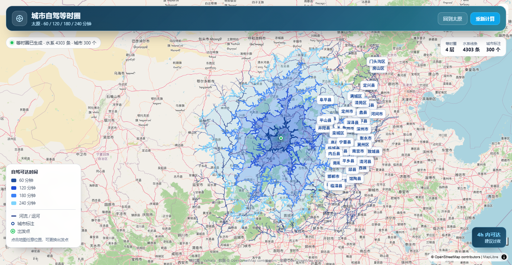

# 城市自驾旅行时间等时圈地图（isochrone-drive-map）

一个可部署在**飞牛 NAS（fnOS）**上的 Docker Compose 项目：输入一个起点（默认太原），
用开源路由引擎 **Valhalla** 计算 60 / 120 / 180 / 240 分钟自驾可达范围，
叠加本地 OSM 提取的河流水系与城市标注，在 **MapLibre GL JS + OpenStreetMap** 底图上展示。

> 不依赖高德/百度/Google 的任何商业地图 Token；不需要下载全国或全球 OSM 数据。
> 默认使用太原周边 4 个省级 PBF（约 276MB），适合 8G–16G 内存的 NAS。



## 效果

- 60/120/180/240 分钟四层半透明蓝色等时圈（由深到浅）
- 深蓝色河流/运河水系线条
- 绿色出发点 + 脉冲动画
- 中文城市标注、图例、**「4h 内可达 建议过夜」**浮层
- 点击地图任意位置可更换起点，重新计算

## 架构

```
浏览器 (MapLibre + OSM raster)
        │  http://NAS_IP:8080
        ▼
frontend-web (Nginx) ── /api/* 反向代理 ──► api-backend (FastAPI)
                                              │
                                              ├─ 读取 /data/water.geojson
                                              ├─ 读取 /data/places.geojson
                                              └─ POST http://valhalla:8002/isochrone
                                                          │
                                                          ▼
                                               valhalla (官方 scripted 镜像)
                                               读取 /custom_files/valhalla_tiles.tar
```

- 只有 `frontend-web` 对外暴露端口（默认 8080）。
- Valhalla 与 API 只在内网 `isochrone-net`，不直接暴露。
- API 带内存 LRU 缓存（相同起点/分钟数不重复请求 Valhalla）。

## 数据范围与资源

| 项目 | 默认值 |
| --- | --- |
| 中心点 | 太原 `37.8706, 112.5489` |
| 默认区域 | 山西、河北、河南、陕西（`REGIONS` 可改） |
| 数据大小 | 约 276MB（4 省 PBF） |
| 首次下载 | 视网络 3–15 分钟 |
| 首次 build tiles | 约 5–15 分钟，Valhalla 内存上限 4G |
| 运行内存 | Valhalla ≤4G，API ≤1G，Nginx 很小 |

> 已在 8G 内存飞牛 NAS 实测：4 省 PBF 共 276MB，生成 `valhalla_tiles.tar` 729MB，
> 构建约 11 分钟；首次等时圈请求约 8 秒，命中后端 LRU 缓存后 <0.1 秒。

> 不建议加入全国数据或 `inner-mongolia` 全量数据；如确实需要，先确认 NAS 有足够内存和磁盘，
> 并在 `.env` 中调整 `REGIONS` 与 `VALHALLA_THREADS`。

## 目录结构

```
isochrone-drive-map/
├── docker-compose.yml
├── .env.example
├── .gitignore
├── README.md
├── data/
│   └── .gitkeep
├── scripts/
│   ├── download_osm.sh
│   ├── build_tiles.sh
│   ├── extract_water_places.sh
│   ├── jq_water.jq
│   └── jq_places.jq
├── valhalla/
│   ├── README.md
│   └── valhalla.json          # 可选参考配置，默认不挂载
├── docs/
│   └── screenshot-01-overview.png
├── backend/
│   ├── Dockerfile
│   ├── requirements.txt
│   ├── main.py
│   ├── valhalla_client.py
│   └── utils.py
└── frontend/
    ├── Dockerfile
    ├── nginx.conf
    ├── index.html
    ├── app.js
    ├── style.css
    └── vendor/                # MapLibre GL JS 本地文件
```

## 飞牛 NAS 保姆级部署教程

### 0. 前置条件

- 飞牛 NAS（x86）已安装 **Docker** 应用，并能正常运行容器
- 内存建议 8GB 以上，磁盘剩余 ≥ 10GB
- NAS 与浏览器在同一局域网
- 能通过 SSH 登录 NAS（下面第 1 步）

### 1. 在飞牛 fnOS 中开启 SSH

1. 用管理员账号登录飞牛 Web 管理页面。
2. 打开 **设置 / 系统设置 → 远程访问 / 终端服务**（不同 fnOS 版本菜单位置可能略有差异）。
3. 找到 **SSH**，打开开关；端口默认 `22`。
4. 在电脑上用 SSH 客户端登录：

```bash
ssh 你的飞牛用户名@192.168.31.219
```

> 如果你的 fnOS 关闭了 SSH 或改了端口，请先开启/确认端口，再继续。

### 2. 在 NAS 创建目录并上传项目

```bash
# 1) 创建项目目录（按你的存储空间路径调整；飞牛常见为 /vol1/1000/...）
sudo mkdir -p /vol1/1000/docker/isochrone-map
sudo chown -R "$USER":"$USER" /vol1/1000/docker/isochrone-map

# 2) 进入目录
cd /vol1/1000/docker/isochrone-map
```

把本项目 `isochrone-drive-map/` 里的所有文件上传到这个目录。可以用：

- 飞牛「文件管理」通过 SMB 共享复制；或
- 在自己电脑上用 `scp -r isochrone-drive-map/* 用户名@NAS_IP:/vol1/1000/docker/isochrone-map/`。

上传后确认：

```bash
ls -la
# 应看到 docker-compose.yml、scripts/、backend/、frontend/、data/ 等
```

### 3. 配置环境变量

```bash
cp .env.example .env
# 如需改端口/区域，编辑 .env
nano .env
```

默认端口 `8080`；如果被占用，把 `WEB_PORT` 改成 `8081` 等空闲端口。

### 4. 下载 OSM 数据（3–15 分钟）

```bash
sudo bash scripts/download_osm.sh
```

脚本会从 Geofabrik 下载山西、河北、河南、陕西的 `.osm.pbf` 到 `data/valhalla/`，约 276MB。
如果网络慢，可以：

- 重试脚本（wget 会断点续传）；
- 或在自己电脑下载后，用 SMB/scp 上传到 `data/valhalla/`。

> **实测国内部分网络无法直连 `download.geofabrik.de`。** 如果 NAS 上 wget 一直超时，
> 请在电脑浏览器打开 <https://download.geofabrik.de/asia/china/>，下载
> `shanxi-latest.osm.pbf`、`hebei-latest.osm.pbf`、`henan-latest.osm.pbf`、`shaanxi-latest.osm.pbf`，
> 再上传到 NAS 的 `data/valhalla/` 目录。脚本检测到文件已存在会跳过下载。

### 5. 构建 Valhalla 路由 tiles（5–15 分钟，重点）

```bash
sudo bash scripts/build_tiles.sh
```

- 会拉取 `ghcr.io/valhalla/valhalla-scripted:latest` 镜像（首次约 1–2GB）；
- 使用 4G 内存上限、2 个线程构建；
- 成功后会生成 `data/valhalla/valhalla_tiles.tar`、`valhalla.json`、`admins.sqlite`；
  若开启时区库（`VALHALLA_BUILD_TIMEZONES=True`），还会生成 `timezones.sqlite`。

> 构建脚本会把 Valhalla 的 `isochrone.max_time` / `max_time_contour` 自动调到 **300 分钟**，
> 否则 180/240 分钟等时圈会被路由引擎拒绝。
> 时区库默认关闭（`VALHALLA_BUILD_TIMEZONES=False`），因为其 shapefile 需要访问 GitHub；
> 等时圈计算不依赖时区库。若你的网络能访问 GitHub，可在 `.env` 中改为 `True`。

**首次构建较慢属于正常现象，请耐心等待，不要关闭 SSH 窗口。**
如果出现 OOM（进程被 kill / 容器退出码 137），请：

```bash
# 减少区域，例如先只做山西
REGIONS="shanxi" sudo bash scripts/download_osm.sh
REGIONS="shanxi" sudo bash scripts/build_tiles.sh
# 或调低线程
VALHALLA_THREADS=1 sudo bash scripts/build_tiles.sh
```

### 6. 提取水系与城市点

```bash
sudo bash scripts/extract_water_places.sh
```

会生成：

- `data/water.geojson`：河流/运河线（默认 `river,canal`）
- `data/places.geojson`：城市/城镇点

如果希望更密集的水系，可在 `.env` 中设置 `WATERWAYS="river,canal,stream"`（数据量会变大）。

### 7. 一键启动

```bash
sudo docker compose up -d --build
```

首次会构建 FastAPI 与 Nginx 镜像（约 1–3 分钟），然后启动 3 个容器。

查看状态：

```bash
sudo docker compose ps
sudo docker compose logs -f valhalla
sudo docker compose logs -f api-backend
```

正常状态：

- `isochrone-valhalla`：`Up (healthy)`（首次启动需要加载 tile）
- `isochrone-api`：`Up (healthy)`
- `isochrone-web`：`Up`

### 8. 在飞牛 Docker UI 查看

1. 打开飞牛桌面 → **Docker** 应用。
2. 在「容器」中可以看到：
   - `isochrone-valhalla`
   - `isochrone-api`
   - `isochrone-web`
3. 点击容器可查看日志、状态、重启/停止。
4. 在「项目 / Compose」中也可以看到 `isochrone-drive-map` 项目（取决于 fnOS Docker 版本）。

### 9. 浏览器访问

在局域网电脑/手机浏览器打开：

```
http://<NAS局域网IP>:8080
```

例如：`http://192.168.31.219:8080`

页面加载后会以太原为中心自动计算 60/120/180/240 分钟等时圈。
点击地图任意位置可更换起点；点击右上角「回到太原」恢复。

### 10. 停止 / 升级 / 备份

```bash
# 停止（数据保留在 data/）
sudo docker compose down

# 重新构建并启动
sudo docker compose up -d --build

# 更新代码后（保留 data/ 和 .env）
sudo docker compose up -d --build

# 备份数据
sudo tar -czf ~/isochrone-data-$(date +%F).tar.gz data
```

## 常用 API

### `POST /api/isochrone`

```bash
curl -X POST http://NAS_IP:8080/api/isochrone \
  -H "Content-Type: application/json" \
  -d '{"lat":37.8706,"lon":112.5489,"minutes":[60,120,180,240]}'
```

返回一个 GeoJSON `FeatureCollection`：

- `properties.layer = "isochrone"`：等时圈多边形，含 `minutes`、`color`
- `properties.layer = "water"`：河流线
- `properties.layer = "city"`：城市点

### `GET /api/health`

查看 API 状态和水系/城市要素数量。

### `GET /api/config`

查看默认中心、分钟数、颜色。

## 配置项

| 变量 | 默认 | 说明 |
| --- | --- | --- |
| `WEB_PORT` | `8080` | 浏览器访问端口 |
| `REGIONS` | `shanxi hebei henan shaanxi` | 下载哪几个省级 PBF |
| `VALHALLA_IMAGE` | `ghcr.io/valhalla/valhalla-scripted:latest` | Valhalla 镜像 |
| `VALHALLA_THREADS` | `2` | 构建/服务线程数 |
| `VALHALLA_BUILD_MEMORY` | `4g` | 构建 tiles 内存上限 |
| `VALHALLA_BUILD_TIMEZONES` | `False` | 是否构建时区库（需要 GitHub 访问） |
| `WATERWAYS` | `river,canal` | 水系类型 |
| `PLACES` | `city,town` | 城市点类型 |
| `PIP_INDEX_URL` | 清华源 | 构建后端时的 PyPI 镜像 |

## 常见问题

### 1. `build_tiles.sh` 失败 / 容器 137

内存不足。减少区域（先只留 `shanxi`）、调低 `VALHALLA_THREADS`，或给 Docker 增加内存。

### 2. API 返回 502 /「起点可能不在路网附近」

- 确认 `data/valhalla/valhalla_tiles.tar` 已生成；
- 确认 `isochrone-valhalla` 日志里出现 `Starting valhalla service`；
- 起点必须在已下载区域的陆路附近，太偏远的点会失败。

### 3. 水系/城市没有显示

运行 `sudo bash scripts/extract_water_places.sh`，确认 `data/water.geojson`、`data/places.geojson` 存在；
然后 `sudo docker compose restart api-backend`。

### 4. 底图空白 / OSM 瓦片加载慢

页面底图使用 `tile.openstreetmap.org`，需要 NAS 浏览器所在网络能访问 OSM。
轨迹/等时圈计算本身不依赖底图；即使瓦片加载慢，等时圈图层仍会显示。

### 5. 端口 8080 被占用

修改 `.env` 中 `WEB_PORT=8081`，然后 `sudo docker compose up -d`。

### 6. `docker compose` 权限不足

飞牛普通用户可能不在 docker 组：

```bash
sudo docker compose up -d --build
```

脚本已自动检测并尝试 `sudo docker`。

### 7. 镜像拉取慢

- Valhalla 镜像较大，可在 Docker 设置中配置镜像加速；
- 后端镜像只依赖 PyPI，已默认使用清华源，可在 `.env` 修改 `PIP_INDEX_URL`。

## 数据来源与许可

- 路由数据：OpenStreetMap，ODbL 许可，© OpenStreetMap contributors。
- 等时圈计算：Valhalla（MIT）。
- 水系/城市：从 OSM PBF 提取。
- 底图：OpenStreetMap raster tiles，遵循 OSM 瓦片使用政策。
- 行政区划/路网数据版权归 OpenStreetMap 贡献者；本项目代码使用 MIT 许可（见仓库根目录 LICENSE）。

> 本项目没有登录鉴权，请只在家庭/公司内网使用，不要把 8080 直接暴露到公网。
